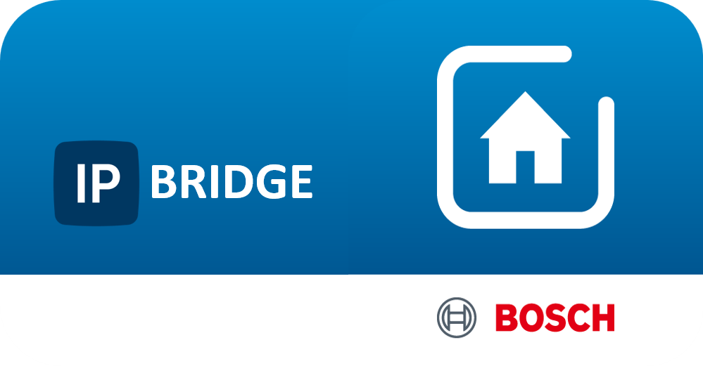
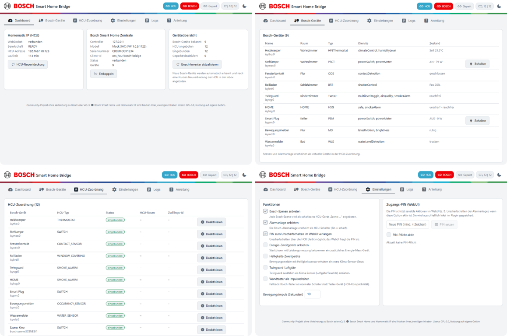

  

# Bosch Smart Home Bridge für Homematic IP

Dieses Plugin verbindet eine **Bosch Smart Home Zentrale (SHC)** mit einer
**Homematic IP Home Control Unit (HCU)**. Bosch-Geräte erscheinen dadurch in
der HCU wie normale Homematic-Geräte: sie sind in der HCU-Inbox sichtbar,
lassen sich Räumen zuordnen, in Programme einbinden und über die gewohnten
Homematic-Bedienelemente schalten.

> **Wichtiger Hinweis:** Dies ist ein privates Community-Projekt. Es steht in
> keiner Verbindung zu Bosch oder zur eQ-3 Entwicklung GmbH und wird von keiner
> der beiden Firmen unterstützt oder geprüft. „Bosch Smart Home“ ist eine Marke
> von Bosch, „Homematic IP“ und „HCU“ sind Marken der eQ-3 Entwicklung GmbH;
> sie werden hier nur verwendet, um die kompatiblen Systeme zu benennen
> (Details in [THIRD-PARTY-NOTICES.md](THIRD-PARTY-NOTICES.md)).
> Die Verwendung erfolgt auf eigene Gefahr – siehe
> [Sicherheit und Haftung](#Sicherheit-und-Haftung).

## Was die Bridge kann

| Bereich | Funktion |
|---|---|
| Geräteübernahme | Fenster- und Türkontakte, Steckdosen und Zwischenstecker, Beleuchtung und Dimmer, Heizkörperthermostate, Rollladen und Jalousien, Rauchmelder, Wassermelder, Bewegungsmelder, Taster |
| Messwerte | Energieverbrauch, Helligkeit und Luftgüte als zusätzliche Homematic-Kanäle, wo das Bosch-Gerät sie liefert |
| Bedienung | Schalten, Dimmen, Sollwert setzen, Rollladenfahren direkt aus Homematic-Oberflächen |
| Automatik | Bosch-Ereignisse lösen Homematic-Programme aus; Homematic-Programme schalten Bosch-Geräte |
| Szenen | Bosch-Szenen erscheinen als schaltbare Homematic-Kanäle |
| Alarm | Scharf-/Unscharfschalten der Bosch-Alarmanlage über Homematic |
| Verwaltung | eigenes Web-Interface für Kopplung, Gerätezuordnung, Einstellungen und Protokoll |

Nicht unterstützt werden Geräte, die nicht über die lokale Bosch-API
angesprochen werden können, insbesondere Bosch-Home-Connect-Geräte
(Waschmaschine, Geschirrspüler und ähnliche Hausgeräte).

## Voraussetzungen

- Homematic IP Home Control Unit (HCU) mit aktueller Firmware und
  aktivierter Möglichkeit zum Laden von Plugin-Images
- Bosch Smart Home Zentrale (SHC) im selben Netzwerk wie die HCU
- Bosch Companion App auf einem Smartphone (für die Pairing-PIN)
- Ein Windows- oder Linux-Rechner mit Docker, wenn Sie das Plugin-Image selbst
  bauen möchten; andernfalls genügt das fertige `tar.gz`-Paket

Alle Komponenten müssen sich im selben lokalen Netzwerk befinden. Eine
Internetverbindung ist für den Betrieb nicht erforderlich.

## Installation

1. Plugin-Image `bosch-hcu-bridge-<version>.tar.gz` von der
   [Releases-Seite](https://github.com/ge2301/HCU_Bosch_Home_Bridge/releases)
   herunterladen (alternativ selbst bauen, siehe
   [Entwickler-Dokumentation](docs/ENTWICKLUNG.md)).
2. HCUweb öffnen, unter **Einstellungen → Plugins** das Image hochladen und
   installieren.
3. Das Plugin startet automatisch und verbindet sich mit der HCU. Die HCU stellt
   dabei Zugangsnachweis und Gerätedaten bereit; Sie müssen keine Token oder
   Schlüssel eintragen.
4. Die Plugin-Konfigurationsseite in der HCUweb zeigt den Status an und enthält
   den Link zum eigenen Web-Interface (Standard: `http://<HCU-IP>:8341`).

## Bosch-Kopplung (Pairing)

Nach der Installation koppeln Sie einmalig Ihre Bosch-Zentrale:

1. Web-Interface der Bridge öffnen (Link auf der Plugin-Konfigurationsseite).
2. Reiter **Einstellungen** bzw. **Dashboard** wählen und die Bosch-Kopplung
   starten.
3. IP-Adresse oder Namen Ihrer Bosch-Zentrale eintragen.
4. Pairing-PIN aus der Bosch Companion App eintragen:
   **Profil → Systemsteuerung → Systemdaten → Pairing-PIN**.
5. Innerhalb von zwei Minuten die Pairing-Taste an Ihrer Bosch-Zentrale drücken
   und im Web-Interface bestätigen.

Die für die Verbindung notwendigen Zugangsdaten werden ausschliesslich lokal
im Datenspeicher des Plugins abgelegt und lassen sich über „Entkoppeln“ vollständig
entfernen.

## Geräte in der HCU

Neu erkannte Bosch-Geräte meldet die Bridge der HCU. Sie erscheinen daraufhin
in der **HCU-Inbox** und werden wie folgt eingebunden:

1. HCUweb öffnen und die Inbox aufrufen (Gerätesuche starten, falls die
   angebotenen Geräte nicht sofort sichtbar sind).
2. Geräte auswählen, Raum und Namen festlegen, Übernahme bestätigen.
3. Nach einer kurzen Neuverbindung erscheinen die Geräte im normalen
   Gerätebestand und können in Programmen verwendet werden.

Das Web-Interface der Bridge zeigt unter **HCU-Zuordnung** für jedes Gerät den
aktuellen Zustand: **eingebunden**, **in Inbox/angeboten** oder **geparkt**.
Über „Deaktivieren“ können Sie einzelne Geräte ruhigschalten, ohne sie zu
löschen; „Aktivieren“ nimmt sie wieder in Betrieb. Neue Bosch-Geräte werden
automatisch nachgemeldet, sobald die HCU sich erneut mit dem Plugin verbindet.

Ausführliche Erklärungen, typische Abläufe und Problemlösungen finden Sie im
Reiter **Anleitung** des Web-Interfaces.

## Konfiguration

Im Reiter **Einstellungen** des Web-Interfaces legen Sie fest:

- welche optionalen Zusatzkanäle (Messwerte, Taster-Verhalten) erzeugt werden,
- wie lange Bewegungsmelder-Impulse wirken,
- ob das Web-Interface eine PIN zum Unscharfschalten verlangt.

Alle Änderungen werden sofort gespeichert und, wo nötig, an die HCU übermittelt.

## Datenspeicherung

Das Plugin speichert seine Einstellungen, die Kopplungsdaten zur Bosch-Zentrale
und ein Laufzeitprotokoll ausschliesslich im lokalen Speicher des Plugins auf
Ihrer HCU. Es werden keine Daten an externe Dienste übertragen. Das
Web-Interface ist ausschliesslich in Ihrem lokalen Netzwerk erreichbar.

## Sicherheit und Haftung

- Dieses Plugin ist **kein zertifiziertes Sicherheitsprodukt** und ersetzt
  keine fachgerechte Planung oder Prüfung sicherheitsrelevanter Einrichtungen
  (Einbruchmeldeanlage, Rauchmelder, Wassermelder, Heizung).
- Verlassen Sie sich bei sicherheitskritischen Funktionen nicht auf die
  Bridge. Prüfen Sie nach jeder Änderung, ob Alarme und Programme wie
  vorgesehen auslösen.
- Das Web-Interface (Port 8341) ist im lokalen Netzwerk ohne zusätzliche
  Verschlüsselung erreichbar. Die optionale PIN ist eine Zugriffssicherung,
  keine Verschlüsselung. Geben Sie diesen Port **nicht** über das Internet frei.
- Für Datenverluste, Sachschäden oder Folgeschäden aus der Nutzung wird keine
  Haftung übernommen. Der Quellcode steht unter GPL-3.0 und ist vollständig
  nachvollziehbar.

## Deinstallation

1. Im Web-Interface die Bosch-Kopplung über „Entkoppeln“ aufheben.
2. Eingebundene Geräte in der HCUweb aus dem Gerätebestand entfernen.
3. Das Plugin in der HCUweb deaktivieren und löschen.

Dabei werden alle Zugangsdaten und Einstellungen des Plugins gelöscht.

## Häufige Fragen

**Die Bosch-Zentrale wird nicht gefunden.**
Prüfen Sie, ob Zentrale und HCU im selben Netzwerk sind und ob die
Pairing-PIN noch gültig ist. Die Pairing-Taste muss innerhalb von etwa zwei
Minuten nach dem Start des Pairings gedrückt werden.

**Geräte sind in der Inbox, aber nicht im Bestand.**
Die HCU übernimmt angebotene Geräte erst nach einer Neuverbindung. Starten Sie
die Gerätesuche in der HCUweb oder verbinden Sie das Plugin kurz neu.

**Ein Gerät lässt sich nicht schalten.**
Kontrollieren Sie im Reiter **HCU-Zuordnung**, ob das Gerät als
**eingebunden** und nicht als **geparkt** angezeigt wird. Geparkte Geräte sind
bewusst ruhigestellt und werden über „Aktivieren“ wieder scharf.

**Kann ich Bosch-Weissware (Waschmaschine und ähnliche Geräte) einbinden?**
Nein. Diese Geräte sprechen über Bosch Home Connect und sind nicht über die
lokale Zentrale erreichbar.

**Muss die Bridge dauerhaft laufen?**
Ja. Ohne laufendes Plugin verschwinden die Bosch-Geräte aus der Steuerung; die
eingebundenen Einträge bleiben als nicht erreichbare Geräte erhalten, bis Sie
das Plugin wieder starten oder die Geräte entfernen.

## Entwickler

Bauen, Testen und Weiterentwicklung sind in der
[Entwickler-Dokumentation](docs/ENTWICKLUNG.md) beschrieben, architektonische
Grundlagen im [PLAN](docs/PLAN-hcu-bosch-plugin.md).

## Lizenz

GNU GPL-3.0 (siehe [LICENSE](LICENSE)). Hinweise zu Abhängigkeiten, Schriften
und Marken: [THIRD-PARTY-NOTICES.md](THIRD-PARTY-NOTICES.md).

Die Homematic IP Connect API stammt von der eQ-3 Entwicklung GmbH, die Bosch
Smart Home Local API von der Robert Bosch Smart Home GmbH. Deren
Beschreibungen wurden nur als Referenz verwendet und sind nicht Bestandteil
dieses Pakets.

Änderungen sind im [CHANGELOG](CHANGELOG.md) dokumentiert.

## Oberfläche im Überblick

